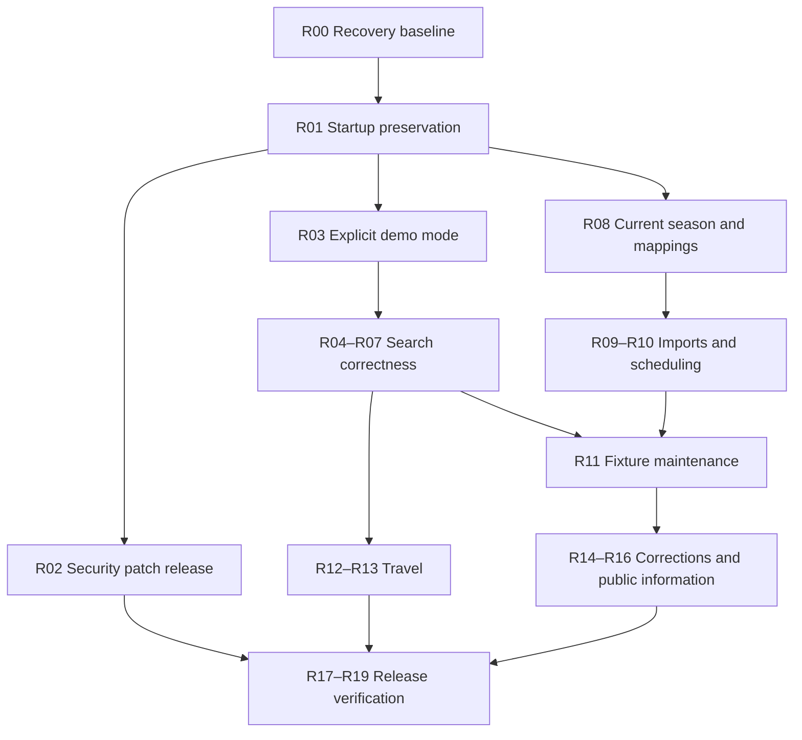

# Dashboard remediation plan

- Date: 19 October 2026
- Status: proposed; implementation has not started
- Baseline: `main` at `d7bdb7b` (10 June 2026) and the public site inspected on 19 October 2026
- Audience: project owner, implementation engineers, and release reviewer

## Objective

Make Near Me FC a reliable finder for nearby upcoming fixtures, with current source data, honest admission and travel information, and admin changes that survive deployment and restart.

Deliver the work in small releases. Preserve SQLite as the product source of truth. Retain the existing Next.js, Node.js, VPS, and SQLite architecture. Use the existing admin and import services as the starting point.

Production releases remain subject to owner review. Every implementation branch targets `main` through a PR, authored as `statcat2017-bots` and requesting review from `statcat2017`. Only `statcat2017` may merge. This plan does not authorize production writes, a merge, or deployment. The current workflow automatically deploys merges to `main`, so review must include release readiness.

Keep the documentation PR in draft until the startup preservation fix is in place. A documentation-only merge also triggers the deployment workflow and could restart the current application with its overwrite behaviour.

## Evidence and limits

| Area | Observed state | Implication |
| --- | --- | --- |
| Availability | Homepage, divisions, pyramid, and database health endpoint returned successfully | Hosting is working; health does not establish data usefulness |
| Fixture search | London, Manchester, and Newcastle searches returned four historical demo fixtures from April–May 2025; a full upcoming-year query also returned those fixtures | Current public search is not serving upcoming fixtures |
| Date boundaries | A request for 23–26 October 2026 returned May 2025 fixtures | Historical fallback bypasses the requested dates |
| Public warnings | API returns historical/demo flags and warnings; dashboard does not render them | Old data can look like normal fixture recommendations |
| Data preservation | Editing a venue name and club admission price in a disposable database, then reopening it through application setup, restored their seed values | Routine startup can overwrite operational edits |
| Dates and times | On Monday 19 October, “This weekend” resolves to 19 October only; import code appends UTC to local kickoff times | Weekend selection and summer kickoff display need correction |
| Coverage | Public pyramid reports 783 clubs, 52 divisions, and 2025–26; 15 Level 10 divisions have no clubs | Coverage and season freshness need explicit handling |
| Travel and prices | Sampled searches returned driving estimates, incomplete transit estimates, and prices checked on 10 May 2026 | Show freshness and missing information clearly |
| Navigation | About/Contact are placeholder links; `/about`, `/contact`, `/privacy` return 404 | Public information pages are unfinished |
| Security dependencies | Registry audit reported 18 affected packages: 3 critical, 13 high, 1 moderate, 1 low; Next.js build version was 15.5.18 | Triage production and development exposure and update supported packages |
| Validation | Latest main passed lint, all 606 tests, and production build under Node 22 | Passing checks currently miss important product failures |
| Tracking | No open PRs; one GitHub issue, #141; several file tickets and sprint plans describe implemented features as unfinished | Reconcile tracking against code and acceptance criteria |

The live site's exact deployed commit was not exposed by health. Browser permissions prevented visual inspection and live admin interaction. Server timers, backups, secret rotation dates, logs, source entitlements, and the full production database were not inspected. These are verification tasks, not confirmed failures. Dependency findings are a dated snapshot; rerun the audit during implementation and assess applicability instead of equating every advisory with an exploitable production route.

Source for the critical Next.js image advisory: [maintainer advisory GHSA-2xp9-vwfh-vxw4](https://github.com/vercel/next.js/security/advisories/GHSA-2xp9-vwfh-vxw4).

## Delivery sequence

| Phase | Work packages | Exit condition | Engineering estimate |
| --- | --- | --- | --- |
| 0. Establish recovery | R00 | Restorable snapshot, confirmed runtime, release baseline | 0.5–1 day |
| 1. Preserve data and patch dependencies | R01–R03 | Restart preserves edits; urgent dependency exposure addressed; demo fallback is explicit | 2–3 days |
| 2. Correct search and presentation | R04–R07 | Date, radius, category, status, price, and warning behaviour is correct | 3–4 days |
| 3. Restore current fixture operations | R08–R11 | Agreed source imports current data; admins can maintain it; failures are visible | 4–6 days |
| 4. Make travel independent of search | R12–R13 | Search works during provider outages; cache coverage is inspectable | 2–3 days |
| 5. Complete public feedback and information | R14–R16 | Corrections reach review; public links and coverage disclosures work | 3–4 days |
| 6. Verify and release | R17–R19 | Critical journeys pass in staging; recovery rehearsed; observation checks pass | 2–3 days |

Allow roughly **20–30 engineering days including contingency**, or **4–6 working weeks for one engineer**, plus owner review and any data-provider lead time. These are planning estimates based on the audit, not fixed delivery dates. Re-estimate after R00/R01. Source access can proceed as an owner task while code work continues. Start regression tests and monitoring with the fixes they protect; phase 6 consolidates evidence and completes verification.

Dependency order:

## Phase 0: Establish recovery

### R00 — Capture the operational baseline

Owner: QA/Release. Priority: P0. Dependencies: none.

- Confirm the deployed commit, Node version, systemd unit, SQLite path, filesystem permissions, environment variable names, provider access, existing timers, and backup arrangements. Record secret names and owners without recording values.
- Take a consistent SQLite snapshot with the backup API or SQLite backup tooling, accounting for WAL. Verify `integrity_check` and foreign-key checks on the snapshot. Record schema version and counts by fixture source, season, status, demo flag, competition, and venue coverage.
- Restore the snapshot into an isolated location and inspect it read-only. Do not boot the current application against that copy before R01: its setup path can reseed it.
- Establish a staging database, test credentials, and provider configuration isolated from production. Exclude real correction emails from shared artifacts.
- Capture current search responses and a baseline of prices, venue edits, assignments, and audit history. Identify records that may already have been overwritten by seed values.

Acceptance: a named backup can be restored; runtime details and ownership are recorded; staging has no production write target. If overwritten values cannot be reconstructed from backups, audit records, or original sources, record that limitation and queue re-verification rather than inventing a repair.

## Phase 1: Preserve data and patch dependencies

### R01 — Separate startup, migrations, and seed data

Owner: Backend. Priority: P0. Dependencies: R00.

- Make normal application startup open the configured database without operational seed upserts. Keep migrations as an explicit deployment step with clear failures.
- Provide explicit initialization and demo-seed commands for development/test databases. Production must fail clearly when required setup is missing instead of silently constructing a demo product.
- If reference data must be added to an existing database, apply an immutable, reviewed migration that preserves edited records and stable IDs.
- Protect club, venue, price, fixture, travel, season, assignment, mapping, and pyramid edits. Inspect all startup upserts, not only the two fields reproduced in the audit.
- Compare a restored snapshot before and after startup and deployment. Recover prior edits only from evidence, through reviewed repair scripts or admin operations.

Acceptance: edit operational records, restart twice, and run the deployment startup path; values and relationships survive. Repeated initialization is deliberate and idempotent. No deployed migration file is rewritten. Regression coverage exercises reopening the same persistent SQLite file, not just an in-memory fresh database.

### R02 — Update dependencies and enforce supported tooling

Owner: Backend / QA/Release. Priority: P0. Dependencies: R00; production rollout requires R01.

- Rerun production-only and complete dependency audits; distinguish runtime exposure from development-tool exposure and record applicable advisory conditions.
- Select currently patched, supported Next.js, React, image-processing, test, and transitive dependency versions. Prefer a tested compatible patch/minor path; assess a major upgrade separately if required for a supported fix. Do not use a forced audit update or downgrade Next.js merely to satisfy the report.
- Commit the lockfile, align framework lint packages, and pin a supported local/CI/runtime Node version. Rebuild native SQLite dependencies for the deployment platform.
- Put lint into PR checks alongside typecheck, tests, and build. Add a dependency update/audit routine with a named owner. Pin deployment actions to reviewed immutable revisions.

Acceptance: no unaddressed applicable critical/high production advisory; other findings have remediation or a time-bound, owner-reviewed explanation. Production standalone startup, admin Server Actions, imports, and SQLite loading pass on the chosen versions. Record final versions and audit date.

### R03 — Make demo mode explicit

Owner: Backend / Frontend. Priority: P0. Dependencies: R01.

- Default `ENABLE_DEMO_FIXTURES` off in production. Exclude both demo and historical data from normal search.
- Remove automatic historical substitution when a requested window has no real fixtures. Return an honest empty result with source freshness/coverage context.
- Preserve date/radius constraints in every normal query. If a demo view offers an old sample window, make that a visible, deliberate choice with its own dates.
- Display a persistent demo banner and per-result identification whenever demo mode is enabled. Carry mode and requested-window metadata into the frontend.

Acceptance: an October search cannot silently return May fixtures; demo flags and warnings reach the rendered page. Launch must tolerate an honest empty state while current imports are being restored.

## Phase 2: Correct search and presentation

### R04 — Use UK dates and kickoff times consistently

Owner: Backend / Frontend. Priority: P1. Dependencies: R03.

- Define “This weekend” as the coming Friday–Sunday on Monday–Thursday, and the remaining Friday–Sunday window on Friday–Sunday. “Next weekend” is the following Friday–Sunday. Monday is excluded from weekend filters.
- Use `Europe/London` calendar boundaries regardless of browser/server timezone. Default search to the next 14 days; retain an explicitly named wider date option.
- Interpret local CSV/HTML times in `Europe/London`, convert to UTC for `kickoff_at`, and preserve local date/time plus confirmed/assumed provenance. Preserve timestamps that already carry a source timezone or offset.
- Handle DST transition ambiguity explicitly. Date-known/time-unknown fixtures must retain their known date in the UI.
- Produce a dry-run list of potentially affected existing imports. Repair only rows whose source data establishes the original local time; never shift all stored kickoffs by one hour.

Acceptance: a supplied 15:00 UK kickoff displays as 15:00 in summer and winter. Tests cover all weekdays, month/year boundaries, UK midnight, DST changes, explicit-offset inputs, assumed times, and unknown times. Any data repair is repeatable without applying the offset twice.

### R05 — Make location and competition filtering trustworthy

Owner: Backend / Frontend. Priority: P1. Dependencies: R03.

- Add 25/50/100/all-mile radius controls, defaulting to 25 miles. Send the selected value to search and provide an expand-radius action on empty results.
- Use valid venue coordinates for inclusion. Calculate distance from the resolved search origin; disclose that travel estimates are cached by postcode district and can vary within it.
- Replace competition-name substring classification with explicit canonical category metadata used consistently by filtering and badges.
- Validate postcodes and disclose approximate origins when lookup fails. Do not silently substitute London for an unresolved location. Bound postcode lookup time and offer a retry or explicit approximate fallback.
- Tie the result heading to the submitted postcode and filters, so editing the input alone does not relabel old results.

Acceptance: radius inclusion/exclusion is correct at boundaries; Northern/Isthmian/Southern premier divisions do not appear as Premier League; cup, friendly, EFL, and women's categories behave correctly. Invalid or unresolved origins cannot produce confidently labelled distances from another place.

### R06 — Render fixture status, provenance, and ticket behaviour

Owner: Frontend / Backend. Priority: P1. Dependencies: R04–R05.

- Include date-matching postponed, cancelled, and unknown-status fixtures with clear labels. Exclude finished fixtures from normal upcoming recommendations and handle matches already started conservatively.
- Suppress ticket CTAs for postponed/cancelled fixtures. Use `Check club tickets` for usable club ticket links and cautious detail links otherwise.
- Show assumed kickoff, approximate venue, demo mode, missing price, missing travel, and stale-data caveats. Put one best-effort disclaimer near results.
- Share presentation rules across featured, desktop, mobile, and admin preview views. Preserve one-off participant display without creating permanent club records.

Acceptance: featured and list views agree; a cancellation is findable but cannot be presented as an attendable ticket opportunity; assumed times never appear confirmed. API fields and UI badges have contract coverage.

### R07 — Make prices useful and attributable

Owner: Frontend / Admin/Data. Priority: P1. Dependencies: R06.

- Preserve fixture override → home-club default → TBC precedence. Verify ticket-link precedence alongside price precedence.
- Render actual source links, checked dates, confidence, and a stale/unknown indicator. Show pence accurately; do not round a £12.50 guide price to £13.
- Proposed policy: mark prices older than 90 days, from another season, or lacking a checked date as needing confirmation. Keep the warning threshold configurable and treat it as a product policy, not a provider guarantee.
- Recheck admission prices and club URLs for the initially supported competitions. Do not manufacture prices or imply inventory/availability from a generic ticket page.

Acceptance: missing and stale prices remain usable with caveats; exact stored amounts and working evidence links are visible; fixture overrides do not leak into another fixture.

## Phase 3: Restore current fixture operations

### R08 — Reconcile season, clubs, venues, and coverage

Owner: Admin/Data / Backend. Priority: P1. Dependencies: R01.

- Inventory production mappings and current allocations against agreed sources. Distinguish structural pyramid coverage, populated club coverage, and actual fixture coverage.
- Set up and verify 2026–27 fixture season metadata and current club/division assignments. Preserve historical fixture provenance and stable club IDs. Use the current assignment model; inspect any season-label changes without recreating retired membership tables.
- Verify promoted/relegated/new clubs, aliases, source IDs, primary venues, coordinates, and competition mappings before importing current PL/Championship data.
- Repair the demo fixture season mismatch: April/May 2025 samples currently carry a 2025–26 label. Retain explicit demo provenance.
- Publish a coverage list. Empty divisions stay labelled as unpopulated or are filtered deliberately; their presence must not imply an active fixture feed.

Acceptance: launch competitions have verified mappings and usable venue coordinates; unsupported or incomplete coverage is explicit; current season labels match actual data. Filling all Level 10 divisions is not a launch dependency.

### R09 — Put live imports through one operational workflow

Owner: Backend / Admin/Data. Priority: P1. Dependencies: R04, R08.

- Confirm football-data.org credentials, available competitions, permitted use, and current-season responses. Verify actual entitlement rather than assuming it from the presence of a token.
- Adapt API data into the existing source/batch/validation/apply pipeline, including season, source IDs, timestamp provenance, row errors, and status updates. The current direct football-data writer must not bypass operational visibility or duplicate reconciliation.
- Report fetched, inserted, updated, unchanged, blocked, and skipped counts with reasons. Unknown clubs or venues enter repair/review rather than silently disappearing.
- Preserve explicit one-off participants, aliases, nonblank admin fields, and trusted data precedence. Retain existing SSRF, fetch-size, and timeout protections for URL import.
- Test replay, reschedules, cancellation, cross-source duplicates, missing fields, and partial failure. Keep ambiguous matches in review. Use atomic writes for fixture changes, batch outcomes, and audit records.
- Start with manual approval of a representative batch. Enable automatic application only for an explicitly approved source after its validation gates have been demonstrated.

Acceptance: one current representative batch reaches correct public search; rerunning it creates no duplicates; cancellation/reschedule updates the same fixture where identity permits; every blocked/skipped row has an operator-visible reason. Import failure cannot erase the last successful dataset.

### R10 — Schedule ingestion and alert on staleness

Owner: QA/Release / Backend. Priority: P1. Dependencies: R09.

- Inspect existing server jobs before adding another scheduler. Use one documented scheduler on the existing VPS, with a lock to prevent overlap, bounded requests, retries/backoff, and provider quota awareness.
- Proposed starting cadence: every six hours where entitlement permits, with an operator refresh command. Record attempt time separately from last successful import and latest source update.
- Alert when two consecutive runs fail, no successful update occurs for 24 hours, or an expected competition unexpectedly loses upcoming coverage. Tune thresholds to the agreed feed cadence.
- Keep serving stored data during failures and show its last successful refresh. Do not revive demo fallback to conceal an ingestion outage.
- Agree the initial non-league source/partnership separately. Until access is agreed, accept only explicitly authorized manual imports and accurately label that limited coverage.

Acceptance: observe one successful scheduled run and one simulated provider failure in staging; retries are bounded; source health is visible; an operator can repair and replay a failed batch. Provider access delays do not block truthful empty states or other remediation.

### R11 — Finish fixture maintenance after import

Owner: Backend / Admin / Frontend. Priority: P1. Dependencies: R06, R09.

- Add or complete protected fixture list/detail/edit pages for date, kickoff provenance, status, participants, venue, source, ticket override, and season.
- Reuse the existing batch repair forms where appropriate; give operators a way to maintain already-imported fixtures without constructing another import batch.
- Add the shared public preview and filters for blocked visibility, missing coordinates, assumed time, source/season, missing prices, and stale information.
- Require authentication, CSRF protection, validated URLs/IDs, atomic mutations, and before/after audit records. Recheck relevant transaction and concurrent-write behaviour against the June admin hardening work.

Acceptance: an admin can postpone a fixture, change venue/time, fix ticket data, and see the correct public result; restart preserves the changes; rejected or failed writes leave no partial changes. Manual edit versus later import precedence is documented and exercised.

## Phase 4: Make travel independent of search

### R12 — Serve cached travel and refresh outside requests

Owner: Backend. Priority: P1. Dependencies: R05, R10.

- Return fixtures using cached estimates or distance-only information without awaiting travel providers. Add finite deadlines for postcode and provider calls.
- Run refresh work through a persistent, bounded VPS job process, using a small SQLite work table if needed. Deduplicate by postcode district/venue, survive restart, and avoid duplicate work from search and prefill paths.
- Keep missing/failed lookups on a retry cooldown. Do not retry every impossible TfL route on every search. Treat transit coverage as provider-limited and provide Google Maps links where estimates are unavailable.
- Mark cache rows older than 90 days stale. Serve stale values with a label while refreshing; preserve valid partial estimates when another provider fails.
- Keep the venue-coordinate change invalidation rule and disclose that estimates are approximate, not journeys timed to kickoff. Confirm whether configured TravelTime credentials have an active supported role before retaining associated claims/configuration.

Acceptance: provider timeout/outage does not delay fixture results; concurrent searches produce one pending job per cache key; failures/backoff survive restart; stale and partially populated cache states render correctly. Sample routes inside and outside London behave honestly.

### R13 — Expose travel coverage to admins

Owner: Admin / Backend. Priority: P2. Dependencies: R12.

- Add the protected read-only cache view with district, venue, provider, calculation date, distance, drive/transit estimates, freshness, and lookup outcome.
- Provide missing/stale/failed/distance-only filters and counts. Link to the documented prefill command and venue detail.

Acceptance: an operator can identify missing or failing travel coverage without querying SQLite directly; no general cache editing UI is required.

## Phase 5: Complete public feedback and information

### R14 — Connect public corrections to a review queue

Owner: Frontend / Backend / Admin. Priority: P2. Dependencies: R11.

- Add `Spotted an error?` on fixture cards with fixture context. Support kickoff, venue, ticket price/link, travel, club details, and other reports; remove the mandatory price requirement for other types.
- Extend the existing corrections schema additively and preserve existing pending reports. Keep optional email, evidence URL, and message with clear limits and confirmation text.
- Add a protected corrections list/detail page and explicit reviewed/rejected/resolved handling with reviewer, timestamp, notes, and audit trail. Show a deliberate correction procedure that uses validated fixture/club/venue edits.
- Never auto-apply a public report. Do not mark it resolved before an operator has verified or corrected the record. Keep import review separate.
- Verify abuse protection and trusted proxy IP handling; document the limitations of process-local rate limiting. Avoid collecting full postcodes or sending correction emails to third-party telemetry.

Acceptance: submit a non-price error → see a pending report → review it as admin → deliberately correct the fixture → mark the report resolved. The initial submission changes no fixture data; unauthorized or invalid status transitions fail; duplicate submissions cannot accidentally apply a change twice.

### R15 — Finish About, Contact, and Privacy

Owner: Frontend / Product owner. Priority: P2. Dependencies: R14 data-handling decisions.

- Build working pages and navigation links. Confirm the actual monitored contact address instead of assuming `hello@nearme.fc` is operational.
- Explain supported competitions, demo mode, data sources, pricing caveats, travel approximation, and the correction review process.
- Document actual correction/email retention, postcode/geolocation processing, external journey links, and any analytics. Obtain owner decisions on contact and retention before publishing definitive claims.

Acceptance: all public navigation/footer links resolve; contact is monitored; privacy copy matches implementation and enabled services. Geolocation remains optional and manual postcode search works after denial.

### R16 — Complete the public coverage and accessibility pass

Owner: Frontend / QA / Admin/Data. Priority: P2. Dependencies: R05–R07, R08, R15.

- Show the verified allocation season and population/fixture coverage on divisions and pyramid pages. Explain approximate grounds and allocation-dependent movement paths.
- Review search, divisions, maps, pyramid, correction forms, and essential admin forms at mobile/tablet/desktop widths with real rendered pages.
- Fix overflow, overlap, unreadable badges, keyboard/focus issues, form labels, loading/error announcements, and map-only information. Ensure fixture details remain available as text.
- Validate empty, partial, stale, cancelled, assumed-time, no-ticket-link, and provider-outage states. A large redesign is not a remediation requirement.

Acceptance: key journeys work at 390, 768, and 1440 pixel widths and with keyboard input; permission denial and network failures are recoverable; documented coverage matches the database. Visual checks remain open until actual browser evidence is obtained.

## Phase 6: Verify and release

### R17 — Add tests around the observed failures

Owner: QA / Backend / Frontend. Priority: P1, delivered alongside each fix. Dependencies: relevant work package.

- Add regression tests for persistent database reopen, strict dates/demo mode, Monday weekends, DST conversion, radius/category filters, status CTA rules, price attribution, and cancellation/reschedule replay.
- Add workflow tests covering import → repair → apply → public search, admin edit → restart, correction → review → deliberate edit, and travel outage → immediate fixture response.
- Repair the stale Playwright test: it expects `All upcoming` while the current button says `All dates`, and must target the visible fixture view rather than ambiguous desktop/mobile containers.
- Use deterministic clocks, isolated temporary SQLite files, mocked external providers, and explicit demo/real fixtures. Run browser smoke tests in CI against an isolated app/database and retain failure screenshots/traces.
- Capture the agreed screenshot set. Keep real provider smoke tests separate from deterministic PR checks.

Acceptance: required PR checks run lint, typecheck, tests, build, and critical browser journeys. New tests demonstrate the audited failures before their fixes; tests check externally meaningful behaviour rather than implementation details.

### R18 — Make deployment and recovery verifiable

Owner: QA/Release. Priority: P1. Dependencies: R00–R02; completed before broad launch.

- Confirm the production DB resides outside disposable release artifacts. Reconcile conflicting documented paths; use the verified path, never an inferred one. Validate configuration at startup.
- Make deploy scripts stop on migration failure before restarting. Preserve a previous compatible release and document rollback without restoring startup reseeding or vulnerable dependencies.
- Add deployed commit/build and migration version to health diagnostics without exposing sensitive paths or secrets. Add a semantic search smoke check; `SELECT 1` alone cannot verify fixture readiness.
- Add daily consistent off-host backups, retention, failure alerts, and scheduled restore rehearsal. Proposed initial targets: recovery point within 24 hours and recovery within two hours; validate these in a drill.
- Record structured errors, import freshness/failures, search latency/empty rates, travel job failures, correction queue age, and disk capacity. Redact credentials, emails, and precise locations. Verify the owner has an actual alert destination before treating alerts as complete.

Acceptance: rehearse restore and application rollback in staging, inject a migration failure, and confirm a failed deployment cannot report success or replace working data. Observe source freshness and semantic search, not just process uptime.

### R19 — Reconcile documentation and backlog

Owner: QA/Release / Product owner. Priority: P2. Dependencies: verification of relevant features.

- Make this plan the current remediation sequence and link it from the README, roadmap, and operations plan after approval. Archive outdated sprint/deployment claims with their replacement link.
- Reconcile each old ticket against implemented behaviour and tests. Mark verified parts done; split remaining acceptance gaps. Keep file status and GitHub tracking aligned.
- Name owners for source access, price checks, correction review, imports, alerts, backups, and releases. Document daily/weekly/monthly operating routines.
- Reassess issue #141 after removal of D1: retain only a concrete current benefit. Avoid broad architecture work whose only justification is the superseded runtime.

Acceptance: another engineer can identify the active work, operate imports, triage corrections, and restore the service from the current docs. Ticket closure cites evidence.

## Existing backlog mapping

R IDs identify packages in this plan, not newly created issue numbers. Reuse the following tickets where their scope fits; create new implementation tickets only for uncovered work.

| Plan work | Existing ticket(s) | Reconciliation |
| --- | --- | --- |
| R00, R01, R18 | 001, 015 | Separate setup repeatability from preservation of existing data; add a dedicated startup overwrite bug ticket |
| R02 | New security/toolchain ticket | Record audit date, applicability, chosen versions, and validation |
| R03–R07 | 046, 005, 054 | Split public readiness into independently verifiable fixes; add focused timezone/weekend bug tickets |
| R08, R16 | 034, 035, 050, 053 | Verify implemented divisions/pyramid UI; separate current-season cleanup from deeper population work |
| R09–R10 | 002, 042, 043, 044, 059–066 | Verify existing CSV/HTML/batch repair implementation before closing parts; track API integration and scheduling as remaining work |
| R11 | 045, 030, 055, 056 | Reuse fixture CRUD/preview scope; limit parsing/transaction cleanup to the touched workflows and remaining demonstrated risks |
| R12–R13 | 048 plus new travel reliability ticket | Existing visibility ticket does not cover removal of provider waits or persistent retry work |
| R14 | 006, 017–021, 047 | Consolidate intake/review overlap; keep automatic correction application deferred |
| R15 | 014 | Verify contact ownership and implemented data handling |
| R17 | 049, 058 | Update existing browser test and add meaningful workflow coverage |
| R18 monitoring | 013 | Establish errors/freshness/alerts first; add usage analytics only with a defined need and matching privacy copy |
| R19 | New backlog/documentation ticket | Update stale statuses only after verification |

Broad module splits (057), trusted contact fast paths, weather (051), partnership marketing, native apps, accounts, favourites, alerts to end users, checkout, seat maps, ticket-purchase automation, and full pyramid population remain outside the remediation critical path. Non-league ingestion remains gated on an agreed data source. Do not make automated trust decisions just to increase the visible fixture count.

## Proposed acceptance targets

These are release targets to validate in staging and production, not claims about current performance.

| Target | Pass condition |
| --- | --- |
| Preservation | Operational edits survive application restart and release deployment; data changes and audits commit together |
| Dates and status | Normal results stay inside requested UK dates and radius; no silent demo substitution; cancellation and assumed time are clearly labelled |
| Current data | Initial supported competitions have an observed successful import, explicit coverage, and last-success freshness; fixture changes propagate on the agreed schedule |
| Search independence | Travel providers can be unavailable indefinitely without preventing results |
| Performance | On representative staging data and 100 mixed warm/cold searches at five concurrent requests, p95 search response under two seconds; bound postcode lookup so no search waits indefinitely; record exceptions and bottlenecks |
| Evidence | Every price has source/date/confidence or an explicit unknown; sample amounts render accurately |
| Security | Applicable urgent advisories addressed; protected admin mutations enforce auth/CSRF; no secrets in source, logs, or build artifacts |
| Corrections | Reports remain pending until reviewed; decisions and deliberate edits are attributable |
| Recovery | Demonstrated restore within the proposed RPO/RTO; failed migration leaves the service recoverable |
| Accessibility | Core search and correction journeys work on target widths and keyboard; maps have textual alternatives |

## Release gates and rollback

1. **Containment release:** verified backup → R01 preservation fix → compatible security patches → explicit demo mode. Exercise the patched standalone artifact on the restored staging database before production. Do not restart old production code merely to check whether reseeding still happens.
2. **Correctness release:** date/time, radius/category, status, warnings, and price presentation. An empty current-data result is acceptable when honestly labelled. Run any timestamp/season repair separately with a reviewed dry-run report.
3. **Data release:** verify current mappings → preview representative source batch → approve/apply in staging → demonstrate idempotence, status updates, and repair → enable the agreed production source and schedule through owner-reviewed rollout.
4. **Operations release:** fixture maintenance, travel jobs/visibility, correction review, public information, and browser acceptance. Release smaller completed pieces as dependencies allow.
5. **Launch decision:** observe at least two successful scheduled import cycles and 48 hours without a blocker; confirm source health, travel fallback, alerts, correction review ownership, and restore evidence. Do not wait for complete national non-league coverage if the published scope is smaller and explicit.

Each code PR runs `npm run lint`, `npm run typecheck`, `npm run test`, and `npm run build`, plus targeted workflow/browser checks. Schema changes use new immutable migrations and are tested against an isolated production-sized copy. Keep schema expansion and data repair separate. SQLite migrations require measuring write locks and planning an appropriate brief maintenance window where necessary; do not assume PostgreSQL-style concurrent DDL applies.

Prefer additive schema changes compatible with the previous safe application release. Roll back application code only to a version that preserves edits and remains compatible with the migrated schema. Correct production data/schema with a reviewed forward repair; do not run destructive down migrations as a routine rollback. A full backup restore requires an explicit recovery decision, write pause, and reconciliation of corrections/admin changes received since the snapshot. Keep those writes in scope when estimating data loss.

## First implementation PRs

1. `fix/startup-preserves-operational-data`: R01, persistent-file regression, and verified staging backup/restore instructions from R00.
2. `fix/security-dependency-updates`: R02, supported tooling, audit evidence, and standalone startup validation; deploy after the preservation fix.
3. `fix/explicit-demo-search-mode`: R03 plus warning banner and date-contract tests.
4. `fix/uk-fixture-dates-and-times`: R04, including a dry-run report for affected imported data.
5. `fix/public-search-filters-and-trust`: R05–R07, split further if review size warrants.

The remaining packages follow the dependency sequence above. File tickets and issues should link back to this plan and record owner, acceptance evidence, migration needs, and rollout/rollback steps.
